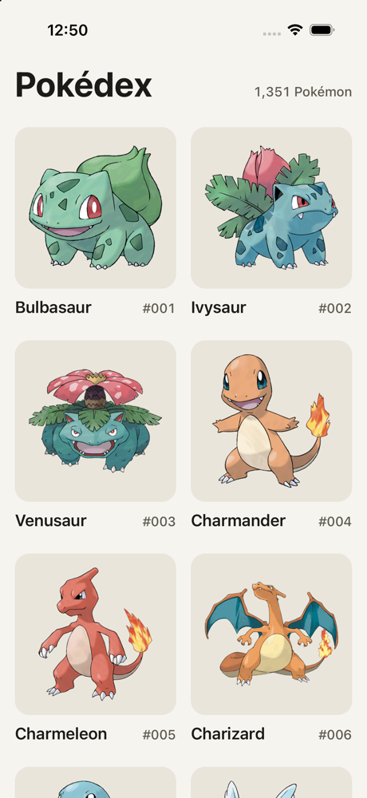
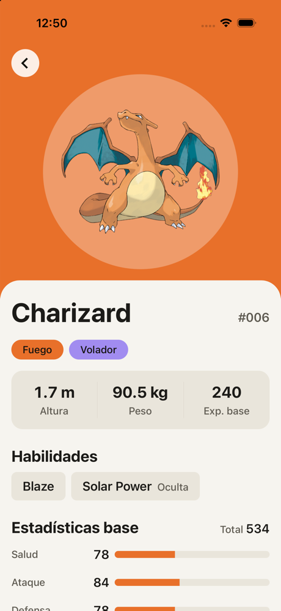
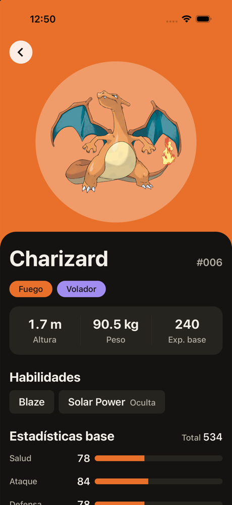
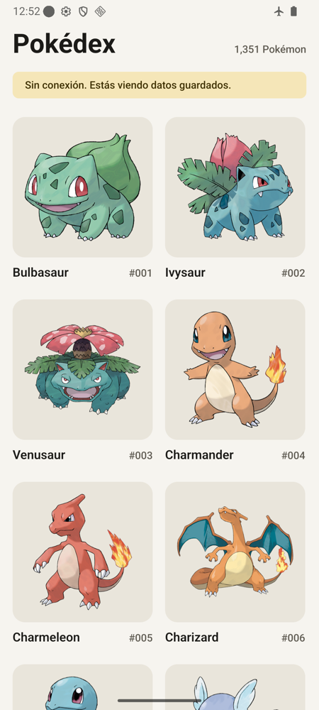

# Pokédex

Aplicación móvil en React Native y Expo que consulta [PokéAPI](https://pokeapi.co/): listado paginado, ficha de cada Pokémon y uso sin conexión de lo ya visitado. Es la entrega del assessment técnico de React Native.

|                      Lista                      |                       Detalle                       |                            Modo oscuro                             |                              Sin conexión (Android)                               |
| :---------------------------------------------: | :-------------------------------------------------: | :----------------------------------------------------------------: | :-------------------------------------------------------------------------------: |
|  |  |  |  |

## Cómo ejecutarla

Requisitos: Node 24 o superior, [pnpm](https://pnpm.io/) 10 y la app [Expo Go](https://expo.dev/go) para el SDK 58, en un dispositivo o en un simulador o emulador.

```bash
pnpm install
```

```bash
pnpm start
```

La app no necesita configuración: funciona sin archivo `.env`.

Después, escanea el QR con Expo Go o presiona `i` (simulador de iOS) o `a` (emulador de Android). También puedes usar `pnpm ios` o `pnpm android` directamente.

## Configuración

Las URLs de la API y de las imágenes se pueden cambiar sin tocar el código. Para hacerlo, copia `.env.example` como `.env`, edita los valores y reinicia Metro.

| Variable                               | Valor por defecto                                             |
| -------------------------------------- | ------------------------------------------------------------- |
| `EXPO_PUBLIC_POKEAPI_BASE_URL`         | `https://pokeapi.co/api/v2`                                   |
| `EXPO_PUBLIC_POKEMON_ARTWORK_BASE_URL` | Ilustraciones oficiales del repositorio de sprites de PokéAPI |

Estas variables quedan dentro del bundle, así que no deben contener secretos. Una URL mal escrita detiene la app al arrancar con un mensaje que nombra la variable, en lugar de confundirse después con un problema de conexión.

## Pruebas y calidad

| Comando              | Qué hace                                                           |
| -------------------- | ------------------------------------------------------------------ |
| `pnpm test`          | Ejecuta las pruebas con Jest                                       |
| `pnpm test:coverage` | Igual, con reporte de cobertura                                    |
| `pnpm typecheck`     | Revisa los tipos con TypeScript                                    |
| `pnpm lint`          | Ejecuta ESLint, incluidas las reglas entre capas                   |
| `pnpm format:check`  | Revisa el formato con Prettier                                     |
| `pnpm verify`        | Ejecuta todo lo anterior salvo la cobertura; es lo que corre en CI |

## Arquitectura

La app sigue Clean Architecture: las dependencias solo apuntan hacia `domain`. ESLint hace cumplir esta regla (`eslint.config.js`), así que una importación que cruce capas falla en CI.

```text
presentation ──> domain <── data <── infrastructure
                   ^
                   └── di/ es el único que conoce todas las capas
```

```text
src/
├─ app/                 # Rutas de expo-router: reexportan pantallas y crean las dependencias
├─ domain/              # Reglas de negocio, sin React, Expo ni Inversify
│  ├─ models/           # Pokemon
│  ├─ enums/            # PokemonTypeName, StatName, AppErrorCode, DataOrigin
│  ├─ types/            # RepositoryTypes
│  ├─ interfaces/       # PokemonRepository, PokemonUseCases
│  ├─ errors/           # AppError
│  └─ usecases/         # GetPokemonPage, GetPokemonDetail
├─ data/                # Implementa el repositorio
│  ├─ dtos/             # PokeApiDtos: forma de las respuestas de PokéAPI
│  ├─ mappers/          # pokemonMappers: de DTO a modelo de dominio
│  ├─ interfaces/       # HttpClient, KeyValueStore, PokemonDataSources
│  ├─ datasources/      # PokeApiRemoteDataSource, KeyValuePokemonLocalDataSource
│  ├─ repositories/     # PokemonRepositoryImpl: estrategia de caché
│  ├─ constants/        # cache: versión de esquema y vencimiento
│  └─ types/            # CacheEntry
├─ infrastructure/      # http/FetchHttpClient, storage/SqliteKeyValueStore
├─ di/                  # container (composition root de Inversify), tokens
└─ presentation/
   ├─ screens/          # Solo deciden qué mostrar según el estado
   ├─ components/       # Piezas de UI, incluidas las secciones de cada pantalla
   ├─ hooks/            # usePokemonDetail, usePokemonGrid, usePokemonHeroLayout, useReducedMotion
   ├─ context/          # DependenciesContext, PokemonListContext
   ├─ utils/            # format, labels, contrast, pokemonColors
   └─ theme/            # Tokens de color, espaciado y tipografía
```

### Estructura de cada pieza

Cada pieza del proyecto, en todas las capas, vive en su propia carpeta y se importa desde su barrel:

```text
PokemonImage/
├─ PokemonImage.tsx         # Implementación
├─ PokemonImage.test.tsx    # Pruebas
├─ PokemonImage.types.ts    # Props y tipos
├─ PokemonImage.styles.ts   # Estilos
└─ index.ts                 # Barrel: lo único que se importa desde fuera
```

Solo existen los archivos que hacen falta: un enum solo lleva su archivo y el barrel, y un hook no lleva estilos. Las pruebas con JSX usan `.test.tsx`.

```ts
import { AppErrorCode } from '@/domain/enums/AppErrorCode';
import { PokemonImage } from '@/presentation/components/PokemonImage';
```

ESLint rechaza las importaciones que se saltan el barrel, como `@/domain/enums/AppErrorCode/AppErrorCode`, y las rutas con `../`.

La excepción es `src/app/`: expo-router trata cada archivo de esa carpeta como una ruta, así que un `index.ts` crearía una ruta que no existe. Tampoco hay barrels en carpetas contenedoras como `domain/enums/`, porque importar una pieza cargaría todas las demás y sería fácil crear ciclos.

### Decisiones técnicas

**Inyección de dependencias con Inversify, sin decoradores.** Todo se enlaza en `src/di/container.ts` con `toDynamicValue`. Las clases de `domain` y `data` usan inyección por constructor y no conocen Inversify, y no hacen falta plugins de Babel para decoradores. La capa `presentation` solo recibe casos de uso mediante `DependenciesContext`, así que tampoco depende del contenedor.

**Estado global con Context y `useReducer`.** Solo el listado es global, porque debe conservarse al navegar. Estado y acciones van en contextos separados para evitar renders innecesarios. El detalle solo le interesa a su pantalla, así que vive en un hook local (`usePokemonDetail`). Una respuesta tardía no puede pisar datos más recientes, porque las respuestas de peticiones obsoletas se ignoran.

**Persistencia: caché primero, con vencimiento.** Los datos se guardan con `expo-sqlite/kv-store` tras la interfaz `KeyValueStore`. Se eligió un almacén clave-valor porque la app guarda respuestas completas y no necesita consultas relacionales; además, las escrituras son atómicas.

| Situación                                  | Resultado                               |
| ------------------------------------------ | --------------------------------------- |
| Hay caché vigente (menos de 24 h)          | Responde sin usar la red                |
| No hay caché vigente, o se refresca a mano | Consulta la red y guarda                |
| La red falla y hay datos guardados         | Los muestra con el aviso «Sin conexión» |
| La red falla y no hay datos guardados      | Muestra el error y permite reintentar   |

Cada registro lleva versión de esquema y fecha; una entrada corrupta o de un esquema anterior se descarta. Si el almacenamiento falla, la app sigue funcionando con la red. Esto da una experiencia offline parcial: está disponible lo que ya se visitó.

**La caché de la app es la única fuente.** Las peticiones se envían con `Cache-Control: no-cache`. Sin esto, la caché HTTP de la plataforma respondía sin red, de modo que un refresco parecía correcto y nunca avisaba de la falta de conexión. Este error se detectó probando en modo avión en Android.

**Imágenes del listado derivadas del id.** El endpoint de lista solo devuelve nombre y URL, pero el id viene en la URL y permite construir la dirección de la imagen. Así se evitan 20 peticiones adicionales por página.

**Errores centralizados.** `FetchHttpClient` traduce los fallos a `AppError` con un código, y `presentation/utils/labels.ts` es el único lugar que los convierte en mensajes para la persona.

**Configuración inyectada.** Solo `infrastructure/config/AppConfig` lee el entorno. El contenedor de Inversify entrega los valores a `FetchHttpClient` y a `PokeApiRemoteDataSource`, de modo que la capa `data` no depende de `process.env`. El tiempo límite y la duración de la caché siguen en el código, porque son decisiones de comportamiento y no cambian por entorno.

**Cabeceras propias.** La app no usa la cabecera nativa. En iOS 26, la cabecera transparente oscurecía el borde superior del detalle e ignoraba el color de la flecha, y el título grande de la lista desaparecía al volver. Por eso la lista tiene un título que colapsa en una barra compacta, y el detalle un botón atrás flotante que se lee igual sobre cualquier tipo de Pokémon. La navegación sigue siendo nativa: el gesto de deslizar desde el borde y el botón atrás de Android son los del sistema.

### Interfaz y accesibilidad

- Estados de carga con skeletons, error, vacío, carga de más páginas y sin conexión.
- Tema claro y oscuro con tokens semánticos.
- Pruebas automáticas que verifican el contraste AA de los pares de texto del tema y del texto sobre cada tipo de Pokémon.
- Etiquetas para lectores de pantalla y áreas táctiles de al menos 48 pt en los botones. Las animaciones respetan la opción de reducir movimiento.
- En el detalle, un círculo claro separa la ilustración del fondo cuando ambos tienen colores parecidos, como Charmander sobre el naranja de Fuego.
- La cuadrícula adapta sus columnas al ancho de la pantalla (2, 3 o 4).
- Rendimiento: `FlatList` virtualizada, elementos memoizados y caché de imágenes en disco.

## Librerías

| Librería                                                 | Para qué                               | Por qué                                                                                            |
| -------------------------------------------------------- | -------------------------------------- | -------------------------------------------------------------------------------------------------- |
| `expo`, `react-native`                                   | Base de la app                         | Pedido por el reto; Expo simplifica la ejecución para quien revisa                                 |
| `expo-router`                                            | Navegación                             | Rutas por archivos sobre React Navigation, con enlaces profundos incluidos                         |
| `react-native-screens`, `react-native-safe-area-context` | Pantallas nativas y áreas seguras      | Requeridas por `expo-router`                                                                       |
| `expo-linking`, `expo-constants`                         | Enlaces y configuración                | Requeridas por `expo-router`                                                                       |
| `react-dom`                                              | Dependencia indirecta de `expo-router` | Fijada en 19.3.0 para coincidir con la versión de React que usa Expo                               |
| `expo-status-bar`                                        | Barra de estado                        | Permite adaptarla al color de cada pantalla                                                        |
| `inversify`, `reflect-metadata`                          | Inyección de dependencias              | Contenedor con ámbitos y sustitución de dependencias; `reflect-metadata` es requisito de Inversify |
| `expo-sqlite`                                            | Persistencia                           | React Native ya no incluye almacenamiento en su núcleo; es un paquete oficial de Expo              |
| `expo-image`                                             | Imágenes                               | Caché en disco: las imágenes ya vistas siguen visibles sin conexión                                |

Solo para desarrollo: Jest, `jest-expo`, Testing Library, ESLint y Prettier.

**Sobre las librerías externas:** la sección 7 del documento del reto pide no usarlas, mientras que la 6 y la 8 permiten elegirlas y justificarlas. Se optó por usar pocas y justificar cada una. Las capas `domain` y `data` no dependen de ninguna de ellas.

## Verificación

Probado manualmente en Expo Go, en un simulador de iPhone 17 Pro (iOS 26.5) y en un emulador de Android 16:

- **iOS:** listado, detalle, regreso con el botón y con el gesto desde el borde, paginación, barra compacta y tema claro y oscuro.
- **Android:** listado, detalle y regreso con el botón atrás propio y el del sistema.
- **Sin conexión (modo avión en Android):** refresco con aviso de datos guardados, detalle ya visitado desde la caché y error con reintento en un detalle no visitado.
- **Configuración:** con un `.env` que apunta a una API inexistente, el refresco falla y la app muestra los datos guardados.

## Trade-offs y mejoras futuras

- **No probado en tablet:** la cuadrícula se adapta al ancho y el contenido del detalle tiene un ancho máximo, pero no se probó en un dispositivo de ese tamaño.
- **Pruebas manuales en Expo Go:** no se generó una compilación nativa de producción.
- **Refresco parcial:** refrescar reemplaza la lista por la primera página; las siguientes se vuelven a cargar al desplazarse.
- **Caché sin límite de tamaño:** crece con lo visitado. Es poco para este alcance, pero una versión real necesitaría una política de limpieza.
- **Nombres de habilidades en inglés:** vienen así del endpoint del Pokémon; traducirlos requiere una petición adicional por habilidad.
- **Posibles mejoras:** búsqueda, filtro por tipo, favoritos y pruebas end-to-end.

## Créditos

Datos e imágenes de [PokéAPI](https://pokeapi.co/). Pokémon y sus nombres son marcas de sus respectivos titulares; este proyecto solo tiene fines de evaluación técnica.
